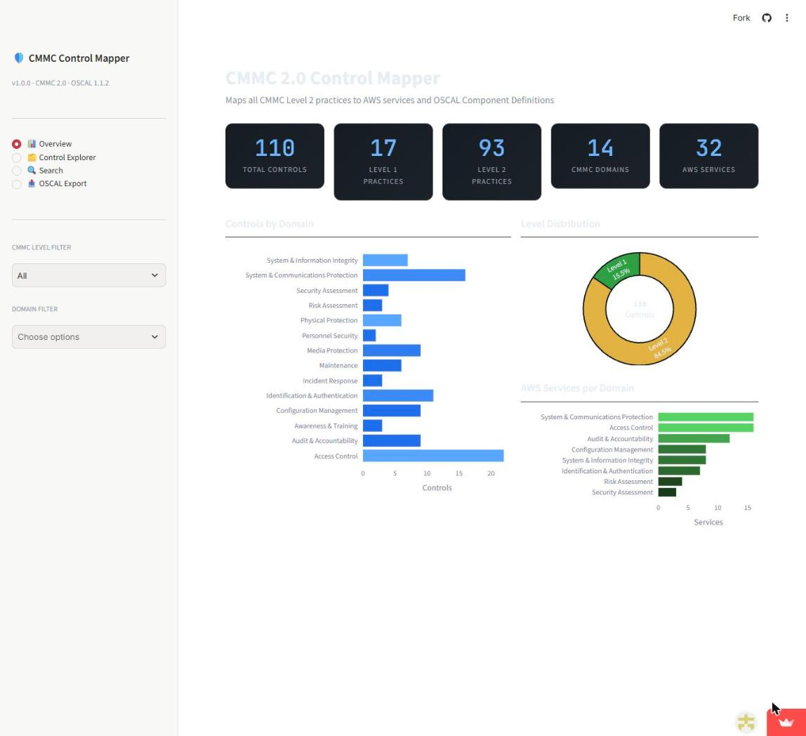
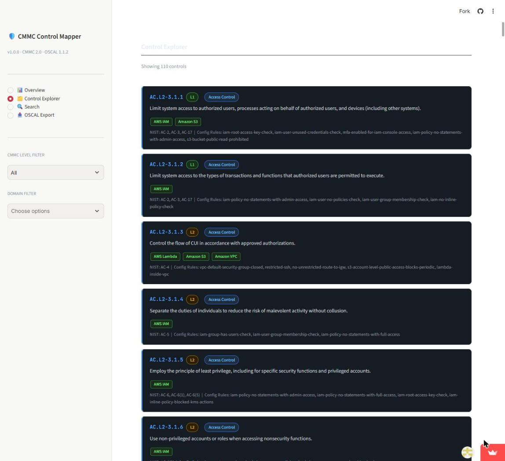
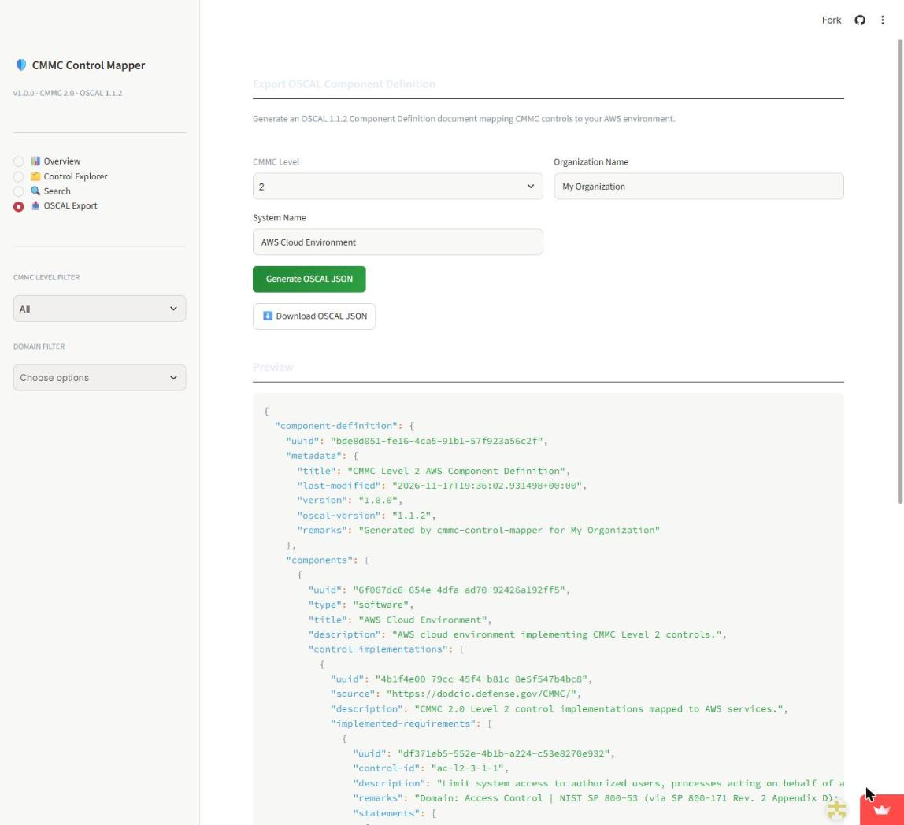

# CMMC Control Mapper


**Maps all 110 CMMC 2.0 Level 2 practices to NIST SP 800-171 Rev. 2, NIST SP 800-53, AWS services, and AWS Config managed rules, and exports an OSCAL 1.1.2 Component Definition.**

[Live Demo](https://cmmc-control-mapper-bzvfqfuaajk5turqzsadhm.streamlit.app/) · [Data sources](#where-the-data-comes-from) · [CLI](#cli-reference) · [Limits](#limits)

---

## Overview

CMMC 2.0 Level 2 requires the 110 security requirements of NIST SP 800-171 Rev. 2, grouped into 14 domains. This tool answers the question a GRC engineer gets on day one of a CMMC effort in AWS:

> **"For each CMMC practice, which AWS services and AWS Config rules give us evidence, and which practices are process-only?"**

| What's in the dataset | Count |
|---|---|
| CMMC Level 2 practices | **110** (all of them) |
| Domains | **14** |
| Practices that are also Level 1 (FAR 52.204-21) | **17** |
| Practices with at least one AWS Config managed rule | **45** |
| Distinct AWS Config managed rules referenced | **75** |
| Practices with at least one AWS service | **72** |
| Practices with neither (training, personnel, media, most policy practices) | **38** |

The 38 practices without an AWS mapping are not gaps in the tool. They are met by people and process (training records, background screening, media handling), and the dataset says so instead of forcing a cloud service onto them.

## Where the data comes from

`data/cmmc_controls.json` is generated by `tools/build_controls.py`, which keeps every source table in plain view. CI regenerates the file and fails if it drifts from the script.

| Field | Source |
|---|---|
| `id`, `title` | DoD CIO, *CMMC Assessment Guide - Level 2*, Version 2.13 (Sept 2024). It writes all 110 practices as `XX.L2-3.x.y`, including the 17 that are also Level 1. |
| `practice` | NIST SP 800-171 Rev. 2 requirement text |
| `nist_mapping` | NIST SP 800-171 Rev. 2, **Appendix D** (Tables D-1 to D-14). Appendix D maps to **SP 800-53 Rev. 4** control IDs. |
| `aws_config_rules` | Selected from AWS's *Operational Best Practices for CMMC 2.0 Level 2* conformance pack. A rule appears only on a practice AWS maps it to. |
| `aws_services` | Derived from the Config rules, plus a short curated list where an AWS feature clearly applies with no Config rule (for example Amazon Time Sync Service for 3.3.7). |
| `level` | `1` for the 17 practices also required at Level 1, `2` for the other 93 |

Older CMMC 2.0 guides wrote the 17 Level 1 practices as `AC.L1-3.1.1`. Lookups accept either form.

### Domains

| Domain | Also L1 | L2 only | Total | With a Config rule |
|---|---|---|---|---|
| Access Control | 4 | 18 | 22 | 10 |
| Audit & Accountability | 0 | 9 | 9 | 5 |
| Awareness & Training | 0 | 3 | 3 | 0 |
| Configuration Management | 0 | 9 | 9 | 6 |
| Identification & Authentication | 2 | 9 | 11 | 7 |
| Incident Response | 0 | 3 | 3 | 1 |
| Maintenance | 0 | 6 | 6 | 1 |
| Media Protection | 1 | 8 | 9 | 0 |
| Personnel Security | 0 | 2 | 2 | 0 |
| Physical Protection | 4 | 2 | 6 | 0 |
| Risk Assessment | 0 | 3 | 3 | 1 |
| Security Assessment | 0 | 4 | 4 | 1 |
| System & Communications Protection | 2 | 14 | 16 | 7 |
| System & Information Integrity | 4 | 3 | 7 | 6 |
| **Total** | **17** | **93** | **110** | **45** |

---

## Dashboard





*These screenshots were taken before the dataset grew from 29 to 110 practices, so the counts in them are older.*

---

## Quick Start

```bash
git clone https://github.com/JulietRodriguez/cmmc-control-mapper.git
cd cmmc-control-mapper
pip install -r requirements.txt
streamlit run dashboard/app.py      # dashboard at http://localhost:8501
```

## CLI Reference

```bash
python cli.py list --level 2                       # all 110 practices
python cli.py list --level 1                       # the 17 Level 1 practices
python cli.py list --level 2 --domain "Access Control"
python cli.py summary                              # counts per domain
python cli.py detail AC.L2-3.1.5                   # one practice (AC.L1-3.1.1 also accepted)
python cli.py search "MFA"                         # searches IDs, titles, text, services, rules, 800-53 IDs
python cli.py export --level 2 --org "Acme Corp" --output acme_cmmc_l2.json
```

Example `detail` output (plain mode, abridged; with `rich` installed it renders as a panel):

```json
{
  "id": "AC.L2-3.1.5",
  "nist_800_171": "3.1.5",
  "title": "Least Privilege",
  "domain": "Access Control",
  "level": 2,
  "practice": "Employ the principle of least privilege, including for specific security functions and privileged accounts.",
  "nist_mapping": ["AC-6", "AC-6(1)", "AC-6(5)"],
  "aws_services": ["AWS IAM"],
  "aws_config_rules": [
    "iam-policy-no-statements-with-admin-access",
    "iam-policy-no-statements-with-full-access",
    "iam-root-access-key-check",
    "iam-inline-policy-blocked-kms-actions"
  ]
}
```

## OSCAL Export

`cli.py export` writes an **OSCAL 1.1.2 Component Definition**: one component (your AWS environment) with one `implemented-requirement` per practice. Practices with AWS services get one statement per service; process-only practices have the requirement text and no statements.

CI validates both the Level 1 and Level 2 exports against NIST's official OSCAL 1.1.2 Component Definition JSON Schema (download pinned by SHA-256).

## Running Tests

```bash
pip install pytest jsonschema
pytest tests/ -v
```

The suite checks the dataset itself, not just the code: exactly 110 practices, the official per-domain counts (AC 22, AT 3, AU 9, CM 9, IA 11, IR 3, MA 6, MP 9, PS 2, PE 6, RA 3, CA 4, SC 16, SI 7), the 17 Level 1 practices, ID format, spot checks against Appendix D, that the JSON file matches its generator, the CLI, and OSCAL schema validity.

## Limits

- **800-53 revision.** The 800-53 mappings are the Rev. 4 IDs from SP 800-171 Rev. 2 Appendix D, because CMMC Level 2 is based on 800-171 Rev. 2. They are not a Rev. 5 crosswalk.
- **Config rules are evidence, not compliance.** A passing Config rule supports a practice; it doesn't prove it. AWS says the same about its conformance packs.
- **Selected, not exhaustive.** AWS maps some practices to 30+ rules. This dataset keeps the most direct 1 to 5 per practice.
- **Shared responsibility.** Physical Protection practices list AWS Artifact because AWS data-center controls are inherited. Your own offices and devices still need their own controls.
- **Endpoint and wireless practices** (mobile devices, Wi-Fi, removable media) have no AWS mapping; they're implemented on endpoints and networks outside AWS.

## Use Cases

- **GRC engineers**: see which practices AWS Config can give evidence for, and which need process evidence.
- **ISSOs / ISSMs**: start an OSCAL Component Definition for a CMMC package.
- **Cloud architects**: pick the AWS services and Config rules to deploy for CMMC coverage.

## Related Projects

- [cmmc-scorecard](https://github.com/JulietRodriguez/cmmc-scorecard): scores Prowler, Security Hub, or manual findings against the same 110 practices.

## License

MIT License. See [LICENSE](LICENSE).
